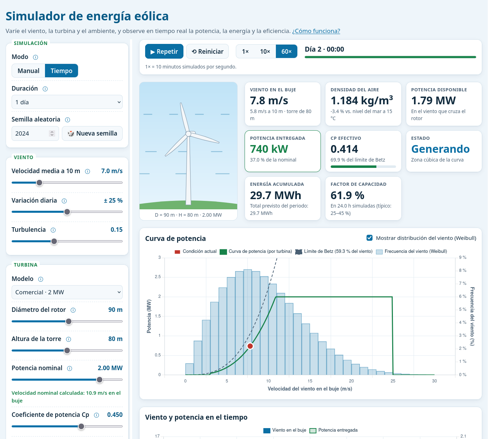
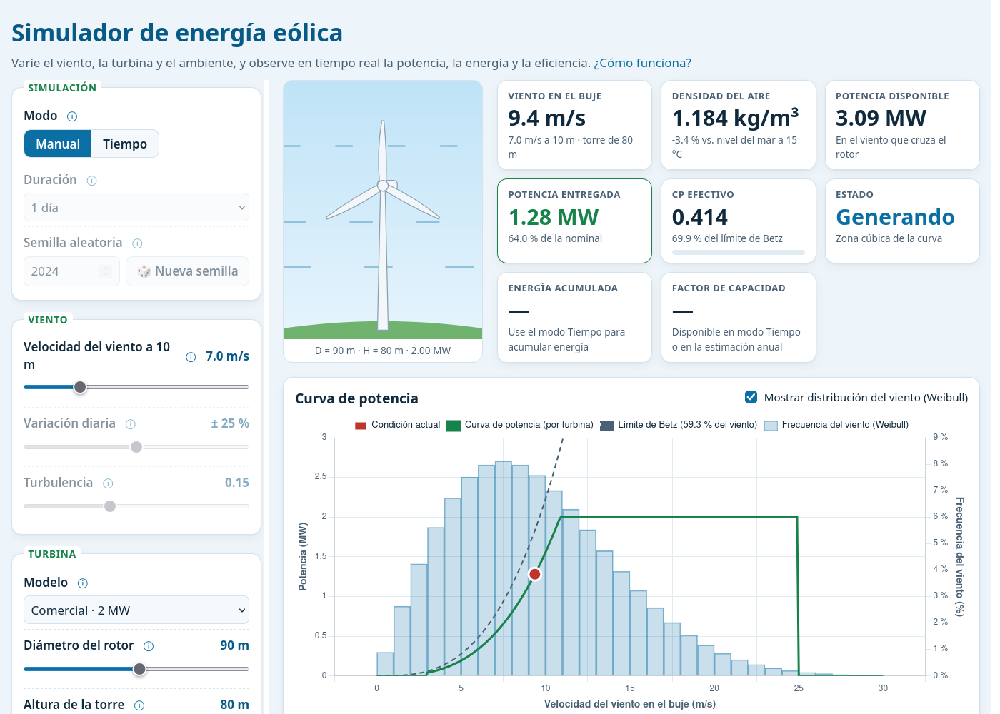

# Simulador de producción de energía eólica

Herramienta web **educativa** para clase: simula una turbina eólica (o un pequeño parque), permite variar el viento y las condiciones ambientales, y muestra en tiempo real la potencia, la energía y la eficiencia.

Es un sitio 100 % estático (HTML + CSS + JavaScript con módulos ES). No necesita compilación, servidor propio ni cuentas de usuario. Chart.js se carga desde un CDN.





## Qué se puede hacer

- **Modo Manual:** se mueve la velocidad del viento y todos los indicadores se actualizan al instante.
- **Modo Tiempo:** se genera un viento sintético con ciclo diario y turbulencia (1 día o 1 semana, en pasos de 10 min), se reproduce a 1×, 10× o 60× y se acumula la energía. La misma semilla produce siempre la misma serie y la misma energía.
- Turbinas predefinidas (10 kW a 5 MW) o personalizadas: diámetro, altura de la torre, potencia nominal, Cp y eficiencia.
- Ambiente: temperatura, altitud y tipo de terreno, más tres escenarios ilustrativos (Costa, Altiplano, Montaña).
- Indicadores: viento en el buje, densidad del aire, potencia disponible y entregada, Cp efectivo y % del límite de Betz, estado, energía acumulada y factor de capacidad.
- Gráficas: curva de potencia con el límite de Betz, el punto de operación y el histograma de Weibull; viento y potencia en el tiempo.
- Estimación anual con la distribución de Weibull, parque de N turbinas con pérdidas por estela y equivalencias (hogares y CO₂).
- Sección **"Cómo funciona"** con las fórmulas y la lista de simplificaciones.
- Modo oscuro automático y diseño adaptable (proyector y celular).

## Modelo físico (resumen)

| Magnitud | Fórmula |
|---|---|
| Presión | `p = 101325 · (1 − 2.25577e-5 · h)^5.25588` |
| Densidad | `ρ = p / (287.05 · T)` |
| Viento en el buje | `v_hub = v_10m · (H / 10)^α` |
| Potencia del viento | `P = ½ · ρ · A · v³`, `A = π (D/2)²` |
| Potencia eléctrica | `P_elec = P · Cp · η`, limitada a `P_nominal` |
| Curva de potencia | 0 si `v < 3 m/s`; `min(P_elec, P_nom)`; 0 si `v ≥ 25 m/s` |
| Parque | `P = N · P_turbina · (1 − pérdidas)` (solo con N > 1) |
| Energía anual | `8760 h · Σ P(v) · f_Weibull(v) · Δv` |

La velocidad nominal no es un parámetro: se calcula como `∛(P_nom / (½ ρ A Cp η))`.

### Supuestos y simplificaciones

- Cp y η constantes; transición brusca a la potencia nominal; sin histéresis en el corte.
- Ley de potencia con α fijo por terreno; densidad con atmósfera estándar y aire seco.
- Viento sintético (no son datos meteorológicos reales); turbulencia de Ornstein–Uhlenbeck con tiempo de correlación de 1 h.
- En el parque todas las turbinas reciben el mismo viento y la estela es un porcentaje fijo.
- La estimación anual usa la velocidad del deslizador como media (llevada al buje) e ignora el ciclo diario.
- Equivalencias: 200 kWh/mes por hogar y 0.5 kg CO₂/kWh. Se pueden editar en `js/presets.js`.
- Los escenarios Costa/Altiplano/Montaña son ilustrativos, no mediciones.

## Estructura

```
index.html
css/styles.css
js/physics.js      Funciones puras del modelo físico (sin DOM)
js/wind.js         Series de viento con RNG con semilla (mulberry32)
js/simulation.js   Indicadores instantáneos y reproductor en el tiempo
js/charts.js       Gráficas con Chart.js
js/turbine.js      Turbina SVG animada
js/presets.js      Turbinas, escenarios, valores por defecto y supuestos
js/ui.js           Controles, eventos e indicadores (punto de entrada)
tests/physics.test.js
```

## Probar localmente

Los módulos ES no funcionan abriendo el archivo con `file://`; use cualquier servidor estático:

```bash
python3 -m http.server 8000
# abrir http://localhost:8000
```

Pruebas del modelo (Node ≥ 18, solo para desarrollo):

```bash
node --test tests/
```

## Despliegue

### GitHub Pages

1. Suba el repositorio a GitHub (rama `main`).
2. En **Settings → Pages**, elija *Deploy from a branch*, rama `main`, carpeta `/ (root)`.
3. En uno o dos minutos el sitio estará en `https://<usuario>.github.io/<repositorio>/`.

Todas las rutas son relativas, así que funciona dentro del subdirectorio del repositorio. El archivo `.nojekyll` evita que GitHub procese el sitio con Jekyll.

### Netlify Drop

1. Entre a <https://app.netlify.com/drop>.
2. Arrastre la carpeta del proyecto completa.
3. Netlify publica el sitio en una URL pública al instante.

No hace falta ningún paso de compilación ni `npm install`. El `package.json` solo define el comando de pruebas.
